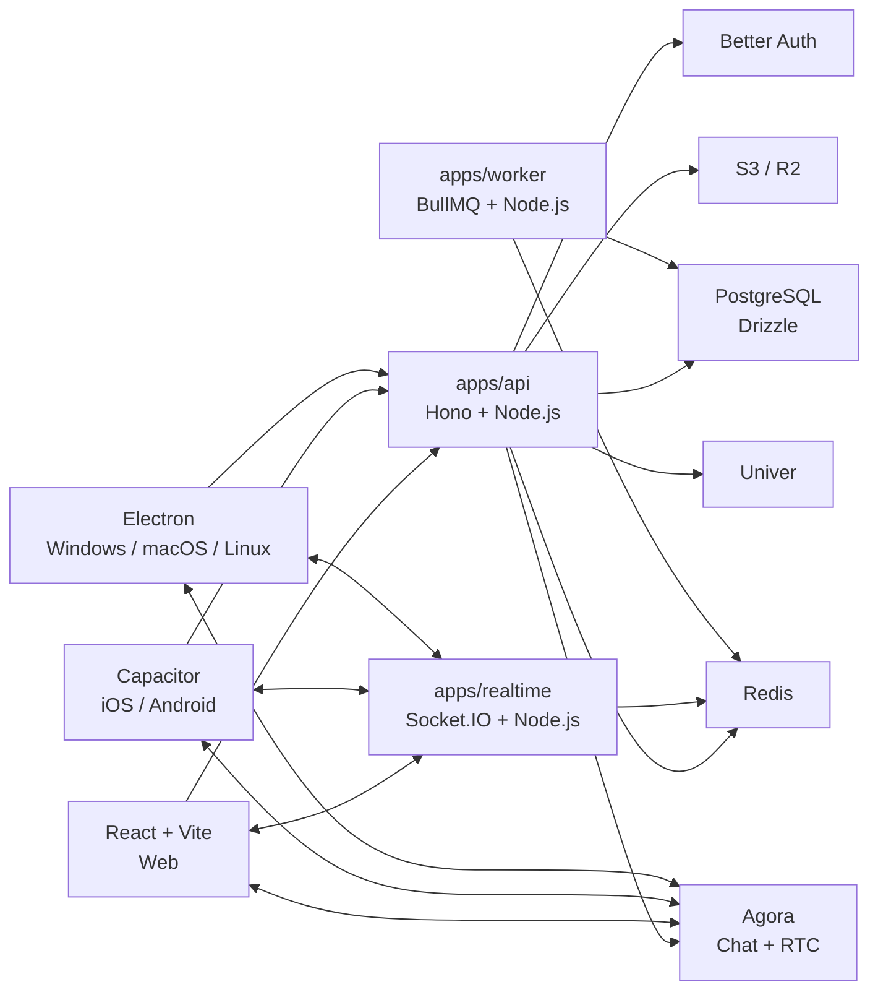
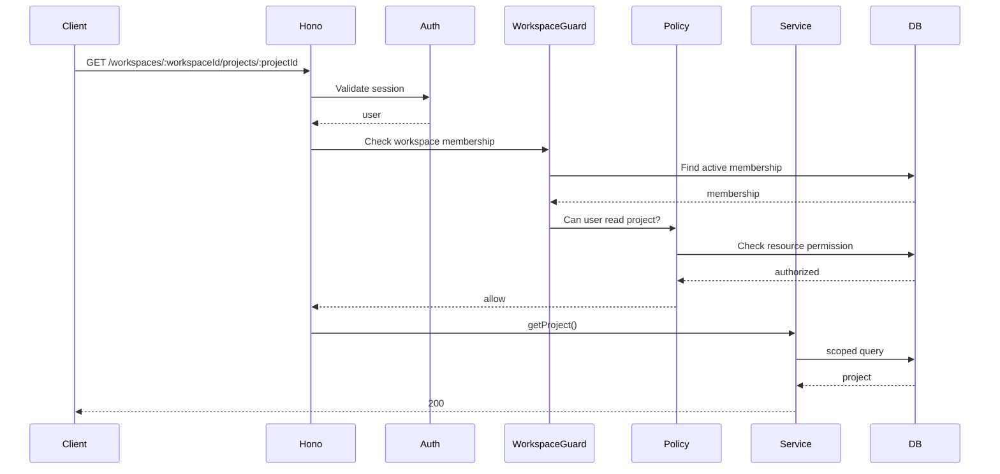
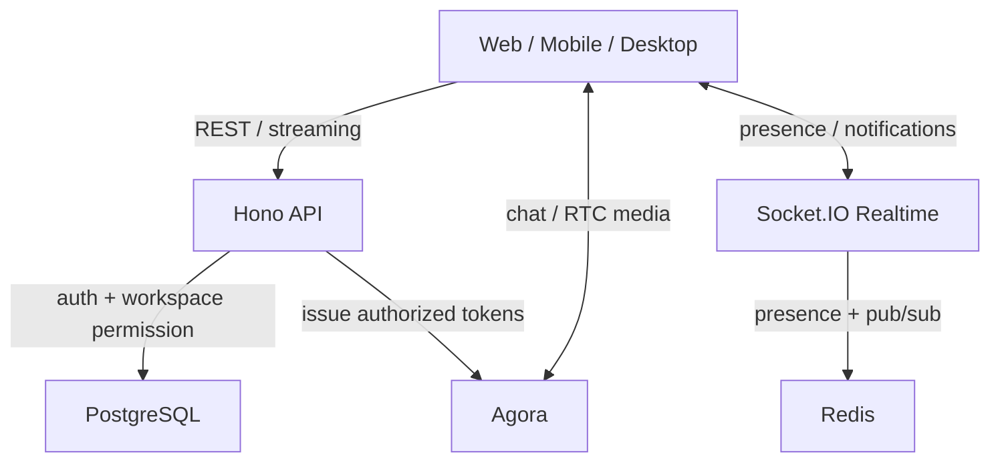

# Hono vs Express, NestJS, Fastify, and Koa for the Collaboration Platform API

## Executive summary

For the planned **Turborepo + TypeScript + React/Vite + Capacitor + Electron + Node.js** collaboration platform, I recommend keeping **Hono as the primary API framework**, running on **Node.js LTS**.

The strongest alternative is **Fastify**, not Express or NestJS.

My ranking for this specific project is:

| Rank | Framework | Verdict for our platform |
|---|---|---|
| **1** | **Hono** | **Recommended** |
| **2** | **Fastify** | Best alternative; run a POC against Hono |
| **3** | NestJS | Excellent framework, but more architecture and runtime machinery than we currently need |
| **4** | Express | Mature and safe, but weaker TypeScript/validation/performance/portability story for a greenfield project |
| **5** | Koa | Clean and lightweight, but gives us fewer advantages than Hono or Fastify |

The main reason to choose Hono is **not that it wins every benchmark**. It does not. In a Fastify-maintained benchmark updated **October 12, 2026**, Fastify 5.12.5 achieved 89,258 requests/sec versus Hono 4.13.13 at 84,885, a roughly **5.2% advantage for Fastify**. Hono nevertheless substantially outperformed Express in that same synthetic benchmark: 84,885 versus 62,054 requests/sec, with 11.30 ms versus 15.63 ms latency. Fastify explicitly warns that these are illustrative framework-overhead measurements and that production workloads should be benchmarked directly. citeturn21view0

Hono's real advantage for us is the combination of:

**TypeScript ergonomics + very small core + Web-standard Request/Response APIs + excellent monorepo type sharing + high Node performance + first-class multi-runtime support + straightforward middleware composition.** Hono's `hono/tiny` preset is under 14 kB, has zero dependencies, and the framework officially targets Node.js, Bun, Cloudflare Workers, Fastly, Deno, AWS Lambda and other runtimes. citeturn20search0turn25search2

It also happens to fit another choice we already made particularly well: **Better Auth**. Better Auth's official Hono integration states that Hono and Better Auth both use Web-standard `Request` and `Response`, so Better Auth can be mounted directly without an adapter. The Express integration requires a Node-handler adapter and has additional middleware-order considerations. citeturn17view5turn17view6

Most importantly, our backend is not intended to be one giant real-time server. The architecture already separates:

- `apps/api`: Hono, HTTP/business API
- `apps/realtime`: Socket.IO, presence and notifications
- `apps/worker`: BullMQ background jobs
- Agora Chat: messaging
- Agora RTC: meetings/calls
- Univer: office editing

That separation makes several NestJS advantages, especially integrated Socket.IO gateways, less valuable to us. Nest does provide first-class, platform-agnostic WebSocket gateways with both Socket.IO and `ws` adapters, but we have deliberately chosen to keep that concern outside the API process. citeturn17view2turn18search20

**Recommended architecture:**



My recommendation is therefore:

> **Use Hono on Node.js LTS for `apps/api`; keep Fastify as the benchmark challenger during the POC; do not move the whole backend to Bun or an edge runtime initially.**

## Decision context and architecture fit

Our API framework needs to be evaluated against the application we are actually building, not against a generic CRUD benchmark.

The backend will eventually contain workspace membership, permissions, contacts, meetings, Drive metadata, Docs/Sheets/Slides metadata, HR workflows, approvals, attendance, tasks, projects, Agora token issuance, search, notifications, audit logs, and storage authorization. Most of those requests will spend materially more time in PostgreSQL, Redis, object storage, authentication, or external services than in the HTTP router itself. Consequently, once Hono and Fastify are both in the "very fast" category, **maintainability, type safety, authorization ergonomics, observability and operational simplicity matter more than a few percentage points of raw router throughput**. The recent Fastify benchmark itself explicitly tells users to reproduce results against their own routes and workload. citeturn21view0

### Why Hono maps particularly well to our monorepo

Our repository design already has shared TypeScript packages such as:

```text
apps/
├── web
├── mobile
├── desktop
├── api
├── realtime
└── worker

packages/
├── app
├── features
├── ui
├── api-client
├── contracts
├── db
├── auth
├── permissions
├── platform
├── agora-client
└── univer
```

Hono provides an RPC/type-inference model that can infer API input and output types into a TypeScript client. That is especially useful when the server and clients coexist in the same monorepo. Hono's middleware type system also carries typed context variables through middleware into handlers. citeturn18search12turn18search8

For example, we can share the server's API shape with our React client:

```ts
// apps/api/src/app.ts
const app = new Hono()
  .get("/api/workspaces/:workspaceId/projects", ...)
  .post("/api/workspaces/:workspaceId/projects", ...)

export type AppType = typeof app
```

and consume it from a TypeScript client without manually duplicating every HTTP response type.

For this project, however, I would **not make Hono RPC the only contract system**. Keep `packages/contracts` with Zod schemas and generate/maintain OpenAPI for stable public boundaries. Hono RPC can then improve internal TypeScript DX without making our mobile/desktop/API architecture inseparable from Hono. Hono explicitly supports validation integrations and type-sharing patterns. citeturn20search1turn18search12

### Workspace isolation favors lightweight typed middleware

Our most important backend requirement is:

```text
authenticate
    ↓
resolve workspace
    ↓
verify active membership
    ↓
verify role/action permission
    ↓
verify resource-level permission
    ↓
execute business logic
```

That fits Hono's middleware model extremely naturally because middleware can attach typed values to the request context. Hono executes middleware in an onion-style pipeline and supports route-specific middleware and typed variables available downstream. citeturn18search12



This same authorization service can be reused by Hono HTTP routes, Socket.IO connection middleware, BullMQ workers when necessary, and Agora token issuance.

### The API framework does not need to own everything

A common argument for NestJS is that it has excellent integrated support for HTTP, WebSockets, queues, microservices, guards, interceptors and dependency injection. That is true: Nest gateways are providers and support Socket.IO and `ws`, and guards/interceptors can be applied to WebSocket handlers similarly to HTTP handlers. citeturn17view2turn18search3turn18search23

But our architecture deliberately separates these responsibilities.

Socket.IO itself is designed to mount on a Node HTTP server, and horizontal Socket.IO deployments can use adapters such as Redis. The current Redis-adapter documentation notes that it forwards packets through Redis Pub/Sub and still requires sticky sessions when HTTP long-polling is enabled. citeturn17view4turn25search3

Therefore:

```text
Hono API
    ≠
Socket.IO realtime server
    ≠
BullMQ worker
    ≠
Agora RTC
```

There is little benefit in adopting a heavier backend framework just because it can combine all of those concerns inside one framework abstraction.

## Comparative evaluation

### Current Node performance

The cleanest recent official comparison I found is Fastify's benchmark page, updated **October 12, 2026**. Because it is maintained by Fastify, it should not be treated as neutral proof that Fastify is universally fastest. It is useful as one reproducible indication of framework overhead, and Fastify itself labels the numbers illustrative. citeturn21view0

| Framework | Version tested | Requests/sec | Latency | Throughput |
|---|---:|---:|---:|---:|
| **Fastify** | 5.12.5 | **89,258** | **10.68 ms** | **16.00 MB/s** |
| **Hono** | 4.13.13 | **84,885** | **11.30 ms** | 13.92 MB/s |
| Koa | 3.2.1 | 75,682 | 12.78 ms | 13.50 MB/s |
| Express | 5.2.1 | 62,054 | 15.63 ms | 11.07 MB/s |

In that particular test, Hono delivered about **36.8% more requests per second than Express** and about **27.7% lower measured latency**, while Fastify was about **5.2% ahead of Hono in requests/sec**. citeturn21view0

That should lead to a nuanced conclusion:

> **Choose Hono for architecture and developer ergonomics, not because of a claim that it is always faster than Fastify.**

Fastify is arguably the strongest Node-only choice from a performance/operability standpoint.

I did not find a sufficiently comparable, current, official cross-framework benchmark for **RSS/heap memory** that I would trust enough to place exact numbers in this report. Memory therefore belongs in our POC rather than being inferred from marketing benchmarks. Hono's tiny core and zero-dependency design suggest low framework overhead, but process RSS will ultimately depend heavily on Drizzle/database drivers, Better Auth, telemetry, validation, Sentry/OpenTelemetry, SDKs and application modules. Hono officially describes its `tiny` preset as under 14 kB and dependency-free. citeturn20search0

### Overall comparison

| Dimension | Hono | Fastify | Express | NestJS | Koa |
|---|---|---|---|---|---|
| Raw Node HTTP performance | **Excellent** | **Excellent / best here** | Fair | Depends on adapter | Good |
| TypeScript DX | **Excellent** | **Excellent** | Good | **Excellent** | Fair–Good |
| End-to-end type inference | **Excellent** | Good | Manual | DTO-oriented | Manual |
| Middleware simplicity | **Excellent** | Very good | **Excellent/familiar** | More layered | **Excellent** |
| Built-in architecture | Minimal | Plugin-based | Minimal | **Very strong/opinionated** | Minimal |
| Validation | Integrations / lightweight | **First-class schemas** | Add library | Pipes/DTOs | Add library |
| Structured logging | Add Pino/etc. | **Pino built in** | Add logger | Strong ecosystem | Add logger |
| Node performance | **Very high** | **Very high** | Lower | Adapter-dependent | High |
| Dependency footprint | **Very small** | Small/moderate | Moderate | Larger | Small core |
| Serverless/cold-start fit | **Excellent** | Good | Good | Fair | Good |
| Cloudflare/edge | **Excellent** | Limited/adapter-oriented | Poor | Poor | Poor |
| Bun | **Official target** | Requires validation | Bun compatibility layer | Requires validation | Requires validation |
| Streaming | **First-class Web Streams** | Node streams | Node streams | Supported | Node streams |
| Native WebSocket story | Good | Good via official plugin | Attach library | **Excellent** | Attach library |
| Socket.IO integration | Good, external | Good | **Very familiar** | **First-class gateway** | Good, external |
| Modular monolith | **Good with conventions** | **Excellent** | Manual | **Excellent** | Manual |
| Auth/authorization | Typed middleware | Hooks/plugins | Middleware | **Guards/decorators** | Middleware |
| Testing | **Very easy `app.request()`** | **Excellent `inject()`** | Mature ecosystem | **Excellent tooling** | Straightforward |
| Edge portability | **Best** | Low–medium | Low | Low | Low |
| Ecosystem maturity | Growing/strong | Strong | **Largest/oldest** | **Very strong** | Mature |
| Learning curve for our team | **Low** | Low–medium | Very low | Medium–high | Low |
| Best fit for us | **Yes** | **Runner-up** | No compelling advantage | Probably overkill | No compelling advantage |

Hono's routing supports grouping/sub-apps, typed middleware context and multi-runtime adapters. Fastify provides a powerful encapsulated plugin model, schema-driven request validation, integrated logging and route hooks. Express remains intentionally minimalist, while Nest adds controllers, dependency injection, guards, interceptors, pipes and modules. Koa intentionally ships without bundled middleware. citeturn18search8turn18search9turn18search13turn19search1turn18search11turn17view3

### TypeScript

**Hono** is particularly attractive in a TypeScript monorepo because request parameters, validated inputs, middleware context and API types can all flow through the type system. Its middleware documentation specifically supports type inference across chained middleware. citeturn18search12

**Fastify** also has excellent TypeScript support. Its official TypeScript APIs support typed request/reply generics, and its type-provider ecosystem can infer types from schema systems including JSON Schema and related providers. citeturn18search19turn23search11

**NestJS** is fundamentally designed around TypeScript and offers the strongest imposed architecture: decorators, dependency injection, providers, controllers, guards and modules. This is beneficial when a large backend organization wants everyone to follow the same conventions, but it also introduces more concepts and lifecycle machinery than Hono. citeturn19search2turn18search11

**Express 5** has improved TypeScript documentation and even infers path parameters through its type definitions, but it does not provide Hono-style server/client type inference or Fastify-style schema-driven typing as a core architectural feature. citeturn23search25

### Routing and modularity

Hono's sub-app model is sufficient for our planned modular monolith:

```text
apps/api/src/modules/
├── auth
├── workspaces
├── contacts
├── meetings
├── drive
├── office
├── people-hr
├── work
└── notifications
```

Each module can export a `Hono` router, service and repository, and the root application mounts it with `.route()`. Hono officially supports grouping applications this way. citeturn18search8

Fastify is arguably stronger if we want strict runtime module encapsulation: its plugin system creates scoped contexts for hooks, decorators and plugins. That is a genuine architectural advantage and is one reason Fastify is our strongest alternative. citeturn18search31turn20search7

NestJS goes further still by making modules/providers/controllers part of the framework's programming model. This can prevent architectural drift in very large teams, but it comes at the cost of more ceremony and a more complex request lifecycle involving middleware, guards, interceptors and pipes. citeturn18search26turn18search11

### Ecosystem and maturity

Express remains the maturity leader and currently has roughly **69.6k GitHub stars**. Nest has about **76.9k**, Fastify about **37.3k**, and Hono about **32.5k** as of this research. GitHub stars are not a quality metric, but they do show that Hono has moved well beyond "experimental niche framework" territory. citeturn24view0turn24view1turn24view2turn24view3

All four major contenders show active current development. Express has active 2026 pull requests and releases; Nest is actively shipping its v12 generation; Fastify's repository is actively developing its next major generation; Hono has ongoing October 2026 development activity. Koa is also maintained, with Koa 3.2.1 released in May 2026. citeturn19search5turn19search10turn19search11turn19search4turn24view4

The practical difference is ecosystem depth. Express still wins when an obscure Node middleware package matters. Fastify has a substantial plugin ecosystem and official plugins. Nest has a large enterprise-oriented ecosystem. Hono's ecosystem is younger, although its built-in middleware already covers areas such as CORS, CSRF, JWT/JWK, body limits, secure headers, caching, compression, request IDs, timing and authentication helpers. citeturn21view4turn20search5

## Framework-specific assessment

### Hono

**Why use it**

Hono gives us almost exactly the level of abstraction we want. It provides routing, typed context, middleware, validation integrations, streaming and WebSocket support without imposing controllers, decorators, dependency injection containers or module metadata. It is built around Web-standard APIs rather than Node's `IncomingMessage`/`ServerResponse` as the application programming model. citeturn18search24turn25search2

That Web-standard foundation matters more than it initially appears. It is why the same application logic can target Node, Bun or Cloudflare Workers with thin runtime adapters, and it also matches browser-side concepts our React developers already understand: `Request`, `Response`, `Headers`, `fetch`, streams and Web APIs. citeturn25search6turn25search9

Hono also has explicit streaming helpers for binary streams, text streams and Server-Sent Events. citeturn23search0

On Node, Hono still gives access to the underlying Node HTTP server when required. Its Node adapter uses `node:http`, returns the underlying server instance, and supports raw Node bindings. citeturn21view3

**Main weaknesses**

Hono is younger than Express, Nest and Koa. Its third-party ecosystem is smaller, and some production concerns that Fastify or Nest formalize more strongly, such as structured logging, dependency injection, schema compilation and module encapsulation, are left to application conventions or external packages. Hono has third-party middleware support and substantial built-ins, but it intentionally remains less opinionated. citeturn18search4turn20search1

That means **we must supply architecture ourselves**. Our previously defined API structure, `service/repository/policy` boundaries, `packages/contracts`, `packages/permissions`, Pino logging and OpenTelemetry conventions become important.

That is a reasonable trade-off because we already have an explicit monorepo architecture.

### Fastify

Fastify is the framework I would choose instead of Hono if our priority shifted to:

- Node-only operation;
- maximum Node HTTP throughput;
- strong schema-first APIs;
- Pino logging out of the box;
- plugin encapsulation;
- mature Node-specific operational tooling.

Fastify describes itself as a low-overhead Node framework centered around a powerful plugin architecture. Its routes support schemas for body, query and parameters; hooks expose a detailed request lifecycle; and the framework exposes built-in request injection for testing. citeturn23search5turn23search20turn18search9turn18search31

It also has an official WebSocket plugin, and Fastify's ecosystem includes Redis, rate limiting, authentication, AWS Lambda and many other integrations. citeturn20search5turn23search17

**Why Hono still wins for us:** the roughly 5% synthetic Node throughput lead does not outweigh Hono's simpler programming model, Web API portability, Better Auth integration and excellent shared-client story for our monorepo. citeturn21view0turn17view5

Still, **Fastify deserves a real POC against Hono**. If Fastify materially wins our representative p99 latency, memory or observability tests, I would be comfortable switching.

### Express

Express remains a completely valid production framework. Express 5 supports modern async handlers more cleanly: rejected promises from middleware/route handlers are forwarded into error handling automatically. Its routing model is familiar to virtually every Node developer, and its ecosystem remains enormous. citeturn18search2turn19search1

For an existing Express application, I would not recommend rewriting merely to use Hono.

For this greenfield platform, however, Express gives us little that Hono or Fastify cannot give us while bringing weaker built-in TypeScript contract integration, lower benchmarked framework performance, Node-only architecture and more reliance on separate middleware packages. Express itself recommends adding middleware such as Helmet for production security practices. citeturn21view0turn23search25

Better Auth is a small but concrete example: Hono mounts Better Auth directly because both use Web Request/Response, whereas Express uses a Node adapter. citeturn17view5turn17view6

**Choose Express instead** only if maximum developer familiarity and compatibility with a specific Express-only middleware ecosystem are more important than the benefits above.

### NestJS

Nest is the most comprehensive framework in this comparison. It offers dependency injection, providers, controllers, guards, interceptors, pipes, WebSocket gateways and strong architectural conventions. The framework officially targets scalable and enterprise-grade server applications and supports either Express or Fastify as its HTTP platform. citeturn19search2turn18search29

For an organization with a large backend team, Nest's enforced structure can be valuable. Workspace authorization could become a reusable `CanActivate` guard, and the same concepts can extend to Socket.IO gateways. citeturn18search11turn18search3

The cost is complexity. A request may travel through middleware, guards, interceptors, pipes and controllers, and providers/modules introduce a dependency graph that must be bootstrapped. Nest's own serverless documentation specifically discusses provider initialization as a contributor to cold-start time and recommends lazy loading modules/providers when startup matters. citeturn18search26turn21view1

For our modular monolith, we can get most of the organizational benefits through folders, services, repositories and explicit policy modules without introducing the Nest container.

Nest becomes more attractive if we later decide:

> "We need a strongly standardized enterprise backend framework more than we need minimalism, portability and direct functional composition."

We are not at that point.

### Koa

Koa remains elegant. It was created by the Express team as a smaller foundation based around async functions and an onion-style middleware model. Importantly, Koa intentionally bundles no middleware in its core. citeturn17view3

That minimalism was highly influential, and Hono's middleware experience feels similarly clean.

But for a new TypeScript collaboration platform, Koa provides fewer modern advantages. We would still need to assemble routing, validation, OpenAPI, security middleware, structured logging, WebSocket integration and contract typing ourselves. `@koa/router` has modern TypeScript support, but the overall framework does not offer Hono's multi-runtime model or Fastify's integrated schema/plugin model. citeturn24view4

It is maintained and reasonably performant, but there is no strong reason for us to choose it over Hono.

## Implementation patterns

The differences become clearer when implementing the same workspace-scoped API.

Assume this shared authorization operation exists regardless of framework:

```ts
type WorkspaceMembership = {
  userId: string;
  workspaceId: string;
  role: "owner" | "admin" | "moderator" | "member";
};

async function findActiveMembership(
  userId: string,
  workspaceId: string,
): Promise<WorkspaceMembership | null> {
  // Drizzle/PostgreSQL query
  return null;
}
```

The rule remains:

> Never trust `workspaceId` simply because the client supplied it. Authenticate first, verify active membership, then verify action/resource permission.

### Hono

```ts
import { Hono } from "hono";
import { createMiddleware } from "hono/factory";
import { HTTPException } from "hono/http-exception";
import { serve, upgradeWebSocket } from "@hono/node-server";
import { WebSocketServer } from "ws";

type User = {
  id: string;
};

type Membership = {
  userId: string;
  workspaceId: string;
  role: string;
};

type Variables = {
  user: User;
  membership: Membership;
};

const app = new Hono<{ Variables: Variables }>();

const requireWorkspace = createMiddleware<{ Variables: Variables }>(
  async (c, next) => {
    const user = c.get("user");
    const workspaceId = c.req.param("workspaceId");

    const membership = await findActiveMembership(user.id, workspaceId);

    if (!membership) {
      throw new HTTPException(403, {
        message: "Workspace access denied",
      });
    }

    c.set("membership", membership);
    await next();
  },
);

app.use("/api/workspaces/:workspaceId/*", requireWorkspace);

app.get("/api/workspaces/:workspaceId/projects", async (c) => {
  const membership = c.get("membership");

  return c.json({
    workspaceId: membership.workspaceId,
    projects: [],
  });
});

app.get(
  "/ws",
  upgradeWebSocket(() => ({
    onMessage(event, ws) {
      ws.send(event.data);
    },
  })),
);

const wss = new WebSocketServer({ noServer: true });

serve({
  fetch: app.fetch,
  websocket: { server: wss },
});
```

Hono's Node adapter officially supports this WebSocket pattern using `@hono/node-server` plus `ws`. citeturn21view3turn21view4

This is particularly nice for workspace middleware because `c.set()` and `c.get()` can carry a fully typed membership through the pipeline. citeturn18search12

### Express

```ts
import express from "express";
import { createServer } from "node:http";
import { Server } from "socket.io";

const app = express();

async function requireWorkspace(
  req: express.Request,
  res: express.Response,
  next: express.NextFunction,
) {
  const user = res.locals.user;
  const workspaceId = req.params.workspaceId;

  const membership = await findActiveMembership(user.id, workspaceId);

  if (!membership) {
    return res.status(403).json({
      error: "Workspace access denied",
    });
  }

  res.locals.membership = membership;
  next();
}

app.get(
  "/api/workspaces/:workspaceId/projects",
  requireWorkspace,
  async (_req, res) => {
    res.json({
      workspaceId: res.locals.membership.workspaceId,
      projects: [],
    });
  },
);

const httpServer = createServer(app);
const io = new Server(httpServer);

io.use(async (socket, next) => {
  // Authenticate socket + validate workspace memberships
  next();
});

io.on("connection", (socket) => {
  socket.on("ping", () => socket.emit("pong"));
});

httpServer.listen(3000);
```

Socket.IO officially mounts on a Node HTTP server, which makes this pattern straightforward with Express. citeturn17view4

The ergonomics are familiar, but attaching strongly typed request context typically requires declaration merging or using `res.locals`; the contract relationship with the frontend is not inherently end-to-end typed.

### NestJS

```ts
import {
  CanActivate,
  Controller,
  ExecutionContext,
  ForbiddenException,
  Get,
  Injectable,
  Param,
  UseGuards,
} from "@nestjs/common";
import {
  MessageBody,
  SubscribeMessage,
  WebSocketGateway,
} from "@nestjs/websockets";

@Injectable()
class WorkspaceGuard implements CanActivate {
  async canActivate(context: ExecutionContext) {
    const request = context.switchToHttp().getRequest();

    const user = request.user;
    const workspaceId = request.params.workspaceId;

    const membership = await findActiveMembership(
      user.id,
      workspaceId,
    );

    if (!membership) {
      throw new ForbiddenException("Workspace access denied");
    }

    request.membership = membership;
    return true;
  }
}

@Controller("api/workspaces/:workspaceId/projects")
@UseGuards(WorkspaceGuard)
class ProjectsController {
  @Get()
  getProjects(@Param("workspaceId") workspaceId: string) {
    return {
      workspaceId,
      projects: [],
    };
  }
}

@WebSocketGateway()
class RealtimeGateway {
  @SubscribeMessage("ping")
  handlePing(@MessageBody() value: string) {
    return {
      event: "pong",
      data: value,
    };
  }
}
```

Nest's `ExecutionContext` is exactly the sort of abstraction that makes guards reusable and declarative, and its gateways provide first-class WebSocket integration. citeturn18search11turn17view2

This is powerful, but it illustrates the additional concepts developers must understand even for a relatively simple route.

### Fastify

```ts
import Fastify from "fastify";
import websocket from "@fastify/websocket";

const app = Fastify({
  logger: true,
});

async function requireWorkspace(
  request: any,
  reply: any,
) {
  const user = request.user;
  const workspaceId = request.params.workspaceId;

  const membership = await findActiveMembership(
    user.id,
    workspaceId,
  );

  if (!membership) {
    return reply.code(403).send({
      error: "Workspace access denied",
    });
  }

  request.membership = membership;
}

app.get(
  "/api/workspaces/:workspaceId/projects",
  {
    preHandler: requireWorkspace,
  },
  async (request: any) => ({
    workspaceId: request.membership.workspaceId,
    projects: [],
  }),
);

await app.register(websocket);

app.get(
  "/ws",
  { websocket: true },
  (socket) => {
    socket.on("message", (message) => {
      socket.send(message);
    });
  },
);

await app.listen({ port: 3000 });
```

Fastify hooks can participate in different request lifecycle stages, and route-level validation/hooks are first-class. citeturn18search9turn18search13

In real production code, we would augment the Fastify request type rather than use `any`, and schemas/type providers would make this substantially more strongly typed.

### Koa

```ts
import Koa from "koa";
import Router from "@koa/router";
import { createServer } from "node:http";
import { Server } from "socket.io";

const app = new Koa();
const router = new Router();

async function requireWorkspace(
  ctx: Koa.ParameterizedContext,
  next: Koa.Next,
) {
  const user = ctx.state.user;
  const workspaceId = ctx.params.workspaceId;

  const membership = await findActiveMembership(
    user.id,
    workspaceId,
  );

  if (!membership) {
    ctx.throw(403, "Workspace access denied");
  }

  ctx.state.membership = membership;
  await next();
}

router.get(
  "/api/workspaces/:workspaceId/projects",
  requireWorkspace,
  async (ctx) => {
    ctx.body = {
      workspaceId: ctx.state.membership.workspaceId,
      projects: [],
    };
  },
);

app.use(router.routes());

const server = createServer(app.callback());
const io = new Server(server);

io.on("connection", (socket) => {
  socket.on("ping", () => socket.emit("pong"));
});

server.listen(3000);
```

Koa's async middleware model is elegant, but because it intentionally provides only the foundation, substantially more application infrastructure must be selected and assembled around it. citeturn17view3

### What this tells us

The Hono version is close to Express/Koa in simplicity while delivering stronger TypeScript context propagation and substantially better runtime portability.

Fastify gives us stronger runtime/schema infrastructure with only moderately more complexity.

Nest gives us the most powerful imposed architecture, but also the most concepts and ceremony.

That is why the actual decision is effectively:

> **Hono vs Fastify**, rather than Hono vs every Node framework.

## Runtime, security, and operational considerations

### Node should remain our production runtime initially

Choosing Hono does **not** mean we should move the backend to an edge runtime.

Our backend will rely on:

```text
PostgreSQL / Drizzle
Redis
BullMQ
Better Auth
Socket.IO
S3/R2
Sentry
OpenTelemetry
Agora server SDK/token generation
Univer integrations
```

A traditional long-running Node deployment gives us the broadest ecosystem compatibility and the simplest operational model for these dependencies.

Hono works very well there. On Node, its official adapter wraps `node:http` and returns the underlying server, so graceful shutdown and standard Node infrastructure remain available. citeturn21view3

Use Hono's portability as **optionality**, not as a mandate to deploy everything to the edge.

### Edge compatibility is still strategically useful

Hono officially supports Cloudflare Workers and other Fetch/Web-standard environments, and Cloudflare's own documentation explicitly includes Hono as a supported framework. Cloudflare Workers provide server-side WebSockets and increasingly broad Node compatibility, although not the entire Node API is universally equivalent. citeturn25search1turn25search13turn25search22

This means we could eventually run lightweight endpoints separately:

```text
Edge
├── public redirect/short-link handling
├── lightweight webhooks
├── health/routing endpoints
├── download authorization
└── geographically sensitive read-only endpoints

Node
├── core API
├── PostgreSQL-heavy operations
├── Redis
├── Agora authorization
├── HR/workspace business logic
├── Socket.IO
└── BullMQ
```

An important 2026 development is that **Vercel standalone Edge Functions are now deprecated**; Vercel recommends its Node.js runtime instead. Therefore "it runs on Vercel Edge" should no longer be treated as a major reason to choose a framework. Hono's portability remains relevant for Cloudflare, Fastly, Bun, Lambda and other environments. citeturn21view2

### Bun is an interesting future runtime, not our baseline

Bun supports Web APIs, provides a high-performance native HTTP/WebSocket server and aims for Node compatibility. Its own compatibility documentation says it is continuing to move toward 100% Node API compatibility, while popular frameworks and npm packages already work. citeturn25search4turn25search12turn25search15

Hono officially targets Bun, so switching the API runtime later is considerably easier than with a strongly Node-coupled architecture. citeturn25search2

But because Bun itself still describes Node compatibility as something it is progressing toward, I would not make it the production runtime until we test our exact stack:

```text
Better Auth
Drizzle/Postgres
Redis
BullMQ
Agora
Sentry
OpenTelemetry
Univer-related server code
```

That is a migration option, not a day-one optimization.

### WebSockets and Socket.IO

Hono has real WebSocket support on Node, Bun, Deno and Cloudflare Workers. On Node, the current implementation uses `@hono/node-server` with `ws`. citeturn21view4turn21view3

But our **presence and notification transport should remain Socket.IO in `apps/realtime`**.

This separation gives us:



Socket.IO is not simply a WebSocket wrapper; it provides its own transport/session model and can use Redis adapters for multi-node broadcasting. citeturn17view4turn25search3

Nest's integrated Socket.IO gateways are attractive if HTTP and realtime are intentionally one framework/application. Since ours are separate services, Hono does not lose much here.

### Agora token issuance is framework-neutral

Agora recommends obtaining production tokens from a server-side token service rather than embedding token secrets in clients. That endpoint is essentially authenticated business logic: validate the user, validate workspace/meeting membership, then mint a short-lived credential. citeturn12search0turn12search6

With Hono:

```ts
app.post(
  "/api/workspaces/:workspaceId/meetings/:meetingId/token",
  requireSession,
  requireWorkspace,
  async (c) => {
    const user = c.get("user");
    const membership = c.get("membership");
    const meetingId = c.req.param("meetingId");

    const meeting = await meetingService.requireJoinAccess({
      userId: user.id,
      workspaceId: membership.workspaceId,
      meetingId,
    });

    const token = await agoraService.createRtcToken({
      userId: user.id,
      channel: meeting.agoraChannel,
    });

    return c.json({ token });
  },
);
```

The important security property is the policy check before token generation, not the framework.

### Authentication

Better Auth is unusually clean with Hono:

```ts
app.all("/api/auth/*", (c) => auth.handler(c.req.raw));
```

The official Better Auth documentation specifically notes that no adapter is required because both use Web-standard Request and Response APIs. citeturn17view5

For our application, authentication and authorization should remain separate concepts:

```text
Better Auth
    ↓
Who is this user?

Workspace middleware
    ↓
Does this user belong to this workspace?

Permission policy
    ↓
Can this membership perform this action?

Resource policy
    ↓
Can this user access this specific file/project/document/HR record?
```

No framework removes the need for those latter checks.

### Security defaults

Hono includes middleware for secure headers, CSRF protection, body limits, JWT/JWK verification, CORS, IP restrictions and other security-related concerns. They are **available but not magically enabled**, so our production bootstrap must install/configure the relevant protections. citeturn21view4

For example:

```ts
import { secureHeaders } from "hono/secure-headers";
import { csrf } from "hono/csrf";
import { bodyLimit } from "hono/body-limit";

app.use("*", secureHeaders());

app.use(
  "/api/*",
  bodyLimit({
    maxSize: 2 * 1024 * 1024,
  }),
);

// For relevant cookie/form endpoints
app.use("/api/*", csrf());
```

Express likewise depends heavily on middleware/configuration for production security. Express's own production guidance recommends measures including TLS, validating user input and Helmet. citeturn9search1

Fastify has an advantage in API input safety because schema validation is central to its route model and it enforces configurable body limits as part of its request parsing architecture. citeturn23search20turn23search23

Nest has excellent security ergonomics through guards and its security packages, but those abstractions primarily improve organization rather than eliminating the need to define correct policies. citeturn18search11turn18search32

### Error handling

Hono supports centralized application error handling and `HTTPException`. That is enough for us to implement a standardized API error contract. citeturn10search3

I would use:

```ts
type ApiError = {
  error: {
    code: string;
    message: string;
    requestId: string;
  };
};
```

and map application errors centrally:

```ts
app.onError((error, c) => {
  const requestId = c.get("requestId");

  if (error instanceof WorkspaceAccessDeniedError) {
    return c.json(
      {
        error: {
          code: "WORKSPACE_ACCESS_DENIED",
          message: "You don't have access to this workspace.",
          requestId,
        },
      },
      403,
    );
  }

  logger.error({ error, requestId });

  return c.json(
    {
      error: {
        code: "INTERNAL_ERROR",
        message: "An unexpected error occurred.",
        requestId,
      },
    },
    500,
  );
});
```

### Observability

This is one area where **Fastify beats Hono out of the box**. Fastify has integrated structured logging and a plugin architecture oriented toward operational Node applications. citeturn18search31turn23search5

Hono provides lightweight logging, request IDs and timing middleware, but for production I would explicitly install:

```text
Pino
OpenTelemetry
Sentry
request ID middleware
structured error logging
metrics
```

That is not a deal-breaker, but it is a real Hono trade-off.

Our request telemetry should include:

```text
requestId
userId
workspaceId
route
method
statusCode
durationMs
dbDurationMs
externalServiceDurationMs
errorCode
```

with appropriate redaction so confidential HR, chat or document content never appears in logs.

### Testing

Hono is particularly convenient for unit/integration-style API tests because an application can be called directly using `app.request()` without binding a TCP port. The official testing documentation uses that model. citeturn10search2

```ts
import { describe, expect, it } from "vitest";

describe("workspace isolation", () => {
  it("rejects a user from another workspace", async () => {
    const response = await app.request(
      "/api/workspaces/workspace-b/projects",
      {
        headers: {
          authorization: `Bearer ${tokenForWorkspaceAUser}`,
        },
      },
    );

    expect(response.status).toBe(403);
  });
});
```

Fastify is equally strong here through its `inject()` API, which is explicitly exposed by the server. citeturn18search31

Nest has excellent testability through dependency injection, particularly when mocks are extensive, but it requires more framework setup. Express/Koa commonly rely on external HTTP test tooling.

## Recommendation and validation plan

### Final recommendation

**Keep Hono.**

I would update our technical decision record to:

> **`apps/api` will use Hono on Node.js LTS. Fastify is the designated fallback and must be included in an early API-framework POC before broad feature implementation.**

The key reasons are weighted as follows:

| Criterion for our platform | Importance | Hono outcome |
|---|---:|---|
| TypeScript monorepo DX | Critical | **Excellent** |
| Workspace auth middleware | Critical | **Excellent** |
| React/mobile/desktop shared contracts | Critical | **Excellent** |
| Node performance | High | **Excellent** |
| Maintainability | High | **Excellent if we enforce conventions** |
| Better Auth integration | High | **Excellent** |
| Runtime portability | Medium | **Best of candidates** |
| Low dependency/cold-start overhead | Medium | **Excellent** |
| Socket.IO support | Medium | Fine because realtime is separate |
| Agora integration | Medium | Framework-neutral |
| Built-in observability | High | **Weaker than Fastify** |
| Enterprise DI/module architecture | Medium | **Weaker than Nest** |
| Ecosystem breadth | Medium | **Weaker than Express/Nest** |

### Why Hono over Express

For a greenfield project, Hono gives us:

```text
Hono
+ better current synthetic HTTP performance
+ stronger TS context/type inference
+ Web Standard Request/Response
+ direct Better Auth integration
+ tiny dependency footprint
+ edge/Bun portability
+ built-in modern middleware
```

while Express mainly gives us:

```text
Express
+ unmatched familiarity
+ massive historical ecosystem
+ very mature production track record
```

Those are valuable advantages, but we do not currently depend on legacy Express middleware enough to outweigh the benefits of Hono. Express 5 is actively maintained and remains perfectly viable, so this is a fit decision rather than a claim that Express is obsolete. citeturn24view1turn19search5

### Why Hono over NestJS

Nest would give us:

```text
Nest
+ dependency injection
+ strict module structure
+ guards / interceptors / pipes
+ first-class WebSocket gateways
+ strong enterprise conventions
```

Hono gives us:

```text
Hono
+ substantially simpler execution model
+ less boilerplate
+ smaller runtime/framework surface
+ Web-standard portability
+ easier functional composition
+ very low barrier for React/TypeScript developers
```

Because Socket.IO is already a separate service and we have a defined modular-monolith folder architecture, much of Nest's extra infrastructure would solve problems we have already chosen to solve differently. Nest's architecture becomes more compelling if our backend organization grows to the point where framework-enforced dependency boundaries provide more value than lightweight composition. citeturn19search2turn17view2

### Why Hono over Fastify

This is the closest call.

Fastify is better today for:

- integrated structured logging;
- Node-specific production ergonomics;
- schema-first validation/serialization;
- encapsulated plugins;
- slightly better current synthetic Node throughput.

Hono is better for us for:

- simpler framework mental model;
- Web-standard APIs;
- smaller core;
- runtime portability;
- direct Better Auth integration;
- typed middleware/context;
- monorepo client/server inference.

The benchmark difference between them is sufficiently small that **our real application benchmark should make the final confirmation**. citeturn21view0turn17view5

### Why not Koa

Koa is clean but lands between Express and Hono without giving us a decisive benefit. We would essentially build many of the features Hono already gives us while losing Hono's runtime portability and richer TypeScript-oriented architecture. Koa remains actively maintained, so this is again about product fit rather than framework quality. citeturn17view3turn24view4

### Hono trade-offs we explicitly accept

Choosing Hono means accepting several real compromises.

**First, the ecosystem is younger.** Express and Nest have larger communities and a longer production history. Hono has significant current adoption and active development, but some unusual Node integration may still have better Express examples or middleware. citeturn24view0turn24view1turn24view2

**Second, architecture is our responsibility.** Hono will let developers put database calls directly inside route handlers if we allow it. Nest would push us much more strongly toward providers/controllers/modules. We therefore need repository conventions and code review enforcement.

**Third, observability is assembled rather than batteries-included.** We should standardize Pino, OpenTelemetry, Sentry and request IDs from day one.

**Fourth, Fastify may outperform it under our actual Node workload.** The latest Fastify-maintained benchmark already puts Fastify slightly ahead in raw HTTP performance. citeturn21view0

**Fifth, portability has limits.** A Hono route written entirely against Web APIs may run across runtimes, but our actual application dependencies may not. BullMQ, database drivers, observability agents or provider SDKs can keep a module Node-specific even when Hono itself is portable. Bun's own documentation still describes Node compatibility as progressing toward complete compatibility. citeturn25search4

Those are acceptable trade-offs.

### POC architecture

Before building the full application, implement the same representative module twice:

```text
apps/
├── api-hono-poc
└── api-fastify-poc

packages/
├── contracts
├── db
├── auth
└── permissions
```

Do **not** waste time implementing full Nest/Express/Koa POCs. The research narrows the serious decision to Hono versus Fastify.

Both POCs should implement exactly the same endpoints:

```text
GET  /health

POST /api/auth/*

GET  /api/workspaces/:workspaceId
GET  /api/workspaces/:workspaceId/members

GET  /api/workspaces/:workspaceId/projects
POST /api/workspaces/:workspaceId/projects

POST /api/workspaces/:workspaceId/meetings/:meetingId/token

POST /api/workspaces/:workspaceId/drive/upload-url

GET  /api/workspaces/:workspaceId/stream
```

Use the actual planned stack:

```text
Node.js LTS
PostgreSQL
Drizzle
Better Auth
Redis
Zod
Pino
OpenTelemetry
Sentry
Agora token generation
```

This is much more meaningful than comparing `/hello-world`.

### Functional POC checklist

The winner must successfully demonstrate:

| Test | Requirement |
|---|---|
| Authentication | Better Auth session works |
| Workspace isolation | User A cannot access Workspace B |
| IDOR resistance | Knowing a foreign resource UUID is insufficient |
| Typed contracts | React client receives correctly inferred/validated types |
| Validation | Invalid params/body rejected consistently |
| PostgreSQL | Real Drizzle query |
| Transactions | Multi-step write rollback |
| Redis | Permission/cache lookup |
| Agora | Secure token issuance |
| Drive | Signed upload/download authorization |
| Streaming | Streaming response works correctly |
| Errors | Standard API error contract |
| Logging | Structured logs with request/workspace IDs |
| Telemetry | OpenTelemetry traces generated |
| Graceful shutdown | HTTP + DB + telemetry close correctly |
| Testing | Direct integration tests without external infrastructure where possible |

### Security POC checklist

Workspace isolation should receive more testing than framework throughput.

At minimum:

```text
✓ non-member cannot list workspace members
✓ non-member cannot fetch a known project ID
✓ non-member cannot download a known Drive object
✓ non-member cannot open a known document ID
✓ non-member cannot obtain an Agora meeting token
✓ removed member immediately loses new API access
✓ member of Workspace A cannot substitute Workspace B's ID
✓ project-level restrictions work after workspace membership passes
✓ HR data remains hidden from ordinary members
✓ admin privileges do not implicitly expose confidential HR data
```

**Expected result: zero unauthorized successes.**

That acceptance criterion matters more than Hono versus Fastify benchmark differences.

### Performance POC

Test three representative routes instead of Hello World.

**Route A: framework overhead**

```text
GET /health
no database
```

This measures basic routing/framework overhead.

**Route B: normal application request**

```text
GET /api/workspaces/:workspaceId/projects
authentication
workspace membership lookup
PostgreSQL query
JSON serialization
logging
OpenTelemetry
```

This represents the majority of our API.

**Route C: security/provider endpoint**

```text
POST /api/workspaces/:workspaceId/meetings/:meetingId/token
authentication
workspace authorization
meeting authorization
database access
Agora token generation
```

Measure:

| Metric | Why |
|---|---|
| successful requests/sec | Capacity |
| p50 latency | Typical UX |
| p95 latency | Tail behavior |
| **p99 latency** | Production-sensitive tail latency |
| error rate | Stability |
| CPU utilization | Cost/scalability |
| baseline RSS | Process overhead |
| peak RSS | Load behavior |
| heap used | JS allocation behavior |
| GC activity | Allocation pressure |
| startup-to-ready time | Cold-start/deploy characteristics |
| container/image size | Operational footprint |
| dependency install size | CI/deployment footprint |

Run each test on identical hardware, identical Node versions, identical database data and identical middleware. Warm the service first, then collect multiple runs. Fastify itself recommends reproducing benchmark results against your own workloads rather than treating published framework numbers as production guarantees. citeturn21view0

A sensible decision rule would be:

> Keep Hono unless Fastify shows a **material and repeatable** improvement on realistic authenticated/database-backed p95/p99 latency, memory or operational simplicity.

A 5% Hello World difference is not enough to justify changing architecture.

A repeatable 20–30% improvement on a real high-volume endpoint or significantly lower memory per replica would be worth reconsidering.

### Developer-experience POC

Have the developer implementing the POC record:

```text
lines of framework-specific code
amount of type boilerplate
time to add a new route
time to add workspace authorization
time to write an integration test
time to expose OpenAPI
time to debug a failed request
quality of editor autocomplete
quality of errors
ease of mocking services
```

This matters because the cost of this application will primarily be **engineering and maintenance**, not HTTP router CPU time.

### Decision after POC

Unless the POC finds something unexpected, the resulting architecture should remain:

```text
Turborepo
│
├── apps/web
│   └── React + Vite
│
├── apps/mobile
│   └── Capacitor
│
├── apps/desktop
│   └── Electron
│
├── apps/api
│   └── Hono + Node.js
│
├── apps/realtime
│   └── Socket.IO + Node.js
│
└── apps/worker
    └── BullMQ + Node.js
```

with:

```text
packages/contracts
packages/db
packages/auth
packages/permissions
```

shared where appropriate.

### Final decision matrix

| Framework | Choose when... | Why not for us? |
|---|---|---|
| **Hono** | TypeScript monorepo, lightweight APIs, Web Standards, possible runtime portability | **No blocking reason; recommended** |
| **Fastify** | Node-only, performance/structured logging/schema-first APIs are top priorities | Excellent alternative, but portability/DX fit slightly weaker |
| Express | Legacy ecosystem compatibility or extreme team familiarity dominates | Less compelling for greenfield TS |
| NestJS | Large backend organization wants strong DI/module conventions and integrated framework facilities | More complexity than our architecture currently needs |
| Koa | You specifically want a minimal onion-middleware Node foundation | Hono provides similar simplicity plus more modern features |
| Bun | You need a JS runtime, not an API framework | Evaluate later underneath Hono |
| Edge/Workers | Specific low-latency/global stateless workloads justify it | Do not move the whole PostgreSQL/Redis/BullMQ backend there initially |

### Bottom line

For this project, I would **not replace Hono with Express or NestJS**.

I would also **not blindly lock in Hono without measuring Fastify**.

The technically defensible choice is:

> **Hono + Node.js LTS for the main API, with an early Hono-vs-Fastify POC using real authentication, workspace authorization, PostgreSQL and observability.**

Hono is the better architectural fit because it stays lightweight while giving our TypeScript team strong typing, clean middleware, Web-standard APIs, straightforward Better Auth integration and future runtime flexibility. Fastify's stronger Node-specific plugin, logging and schema architecture makes it the only alternative likely to change that conclusion after benchmarking. citeturn20search0turn17view5turn21view0

The framework should remain only the HTTP boundary. **Workspace authorization belongs in reusable application policies; PostgreSQL remains the source of truth; Socket.IO remains a dedicated realtime service; Agora handles chat/RTC; BullMQ handles jobs.** That separation is more important to the long-term quality of this Lark-like platform than whether the router handles 85,000 or 89,000 synthetic requests per second.

**Primary documentation and source links:** [Hono](https://hono.dev/docs/), [Hono Node.js adapter](https://hono.dev/docs/getting-started/nodejs), [Hono WebSocket helper](https://hono.dev/docs/helpers/websocket), [Fastify](https://fastify.dev/docs/latest/), [Fastify benchmarks](https://fastify.dev/benchmarks/), [Express 5](https://expressjs.com/en/5x/api/), [NestJS](https://docs.nestjs.com/), [Koa](https://koajs.com/), [Socket.IO](https://socket.io/docs/v4/), [Bun](https://bun.sh/docs), and [Cloudflare Workers](https://developers.cloudflare.com/workers/). These sources were prioritized alongside the frameworks' official GitHub repositories and current official integration documentation. citeturn25search2turn21view0turn23search7turn19search2turn17view3turn25search15turn25search9