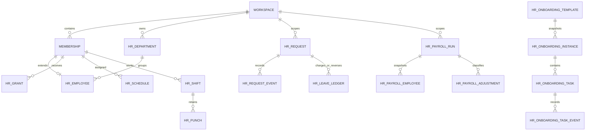

# People & HR

## Discovery (phase 0)

The implementation specification is `docs/implementation_plans/05-people-hr-implementation-plan.md`.
All 16 PNGs were opened and inspected before implementation:

| Sample directory | Files | Mapping |
| --- | --- | --- |
| `1_Approvals` | `1_Approvals_Page.png`, `2_New_Request_Page_(But it should be a modal).png` | Three queues; request-type picker inside a Radix dialog |
| `2_Leave` | `1_Leave_Page.png`, `2_Who_is_out_page.png`, `3_Team_balances_Page.png` | Balance cards, absence calendar/list, team balance table |
| `3_Attendance` | `1_Attendance_Page.png`, `2_Attendance_Page_(Clock in is clicked).png` | Clock states, four monthly metrics, full month timesheet |
| `4_Payroll` | `1_Payroll_My_Pay_tab_page.png`, `2_Payroll_Pay_runs_tab_page.png`, `3_Payroll_Employees_tab_page.png`, `4_Payroll_Settings_tab_page_part-1.png`, `5_Payroll_Settings_tab_page_part-2.png`, `6_Payroll_Settings_tab_page_part-3.png` | Payslips and estimate, runs, confidential roster, schedule/access/rules settings |
| `5_Onboarding` | `1_Onboarding_My_Steps_tab_page.png`, `2_Onboarding_Checklists_tab_page.png` | Personal tasks, checklist progress, template builder |
| `6_People` | `1_People_page.png` | Searchable directory cards, org hierarchy; add departments per specification |

### Existing integration points

- Better Auth uses `users`; membership identity is the composite `(workspace_id, user_id)` in `workspace_members`, not a synthetic membership ID.
- `apps/api/src/modules/workspaces/workspace.service.ts` owns membership, invitations, and the shared workspace transaction lock. HR reuses it, including checks after lock acquisition.
- Hono handles authenticated `/api/v1` routes, JSON/origin validation, no-store responses, sanitized errors and rate limits. HR lives under `/workspaces/:workspaceId/hr` in `apps/api/src/modules/hr`.
- Drizzle lives in `packages/database`; existing monolithic schema is split with unchanged definitions and exports before feature migrations.
- Shared Zod inputs/DTOs and capability names live at `@lumo/contracts/hr`. No browser imports server code.
- `packages/app/src/features/hr` owns all six screens and TanStack Query composition. File routes use the existing authenticated workspace layout. Web and Electron consume these same screens and the platform transport.
- `@lumo/ui` supplies dialogs, fields, selects, tables, cards, progress, avatars, errors, buttons, and theme tokens. Keep the current logo and light/dark blue theme, responsive shell and desktop header.
- Drive storage exposes verified presigned uploads and short-lived downloads. Restricted HR files use isolated keys and independent relationship authorization; they must never enter general Drive listings or inherit workspace-wide sharing.
- Existing audit events have no before/after payload; a protected HR audit stream adds safe structured change history. There is no general application-notification service (only Wiki invalidation); HR uses durable recipient-scoped inbox records.
- Integration tests use real PostgreSQL, isolated random schemas on `TEST_DATABASE_URL` ending `_test`; Playwright covers browser and Electron.

### Data and authorization boundaries

Employment profiles extend workspace membership; job titles and global user profiles never grant authority. Owner has all HR capabilities. All other roles, including admin, need explicit grants. Grants can be workspace-wide or direct-report scoped for team attendance/leave; own access is a relationship check. Sensitive access administration forbids self-escalation. Salary queries, exports and audit records have dedicated guards and narrow serializers.

Canonical approval requests carry validated discriminated details for all seven types; leave/overtime reuse their status rather than copying workflow state into another table. Leave ledger entries reference that canonical request. Ordered steps and immutable decision events preserve history. Daily attendance retains raw punches plus reviewed corrections. Payroll snapshots effective compensation, rules, attendance, approved leave/overtime and classified adjustments; closed runs remain immutable. Onboarding assignments snapshot templates and retain task events.

### Deliberate adaptations

- Sample attendance copy says device clock; authoritative punch time comes from the server.
- Sample payroll copy grants admins payroll access; generic admin has no payroll access here.
- Sample leave figures and payroll rates are illustrative only. No fabricated entitlements or salaries are seeded.
- Payroll tabs use the specification's exact capitalization: My Pay, Pay Runs, Employees, Settings.
- Only explicitly supported pay models/frequencies are selectable. Statutory validation and reviewer sign-off are separate from software implementation; estimates cannot bypass finalization checks.
- PDF infrastructure is absent; reproducible authenticated CSV payslip downloads are used.

## Delivery log

- Phase 0 (`bda87a2`): repository and all PNG discovery; integration and permission map.
- Phase 1 (`e69967f`, `50f467f`): no-op schema-folder refactor, scoped employment/capability foundations.
- Phase 2 (`c4c57f7`): directory, employment profiles, departments and manager placement.
- Phase 3 (`63bbd97`): canonical typed approvals, sequential routing, immutable history and private evidence.
- Phase 4 (`2e68ad0`): policy-aware leave, accrual/carryover/expiry ledger, approval and cancellation effects.
- Phase 5 (`dd61a96`): server-time clock state machine, complete timesheets, reviewed corrections and CSV.
- Phase 6 (`0fde297`): effective compensation/settings, deterministic payroll, independent review and publication.
- Phase 7 (`3b10ef2`): versioned onboarding, private task evidence and invitation activation.
- Phase 8 (`43e178c`): administration, protected audit/inbox, removal hardening and shared navigation.
- Phase 9: migration upgrade regression, broad rule/API/UI tests, shared real web/Electron workflows,
  source-boundary corrections, final filter/scheduling controls, OpenAPI and operational documentation.

## Delivered structure and schema map

The six shared routes are `/w/:workspaceId/{approvals,leave,attendance,payroll,hr-onboarding,people}`.
`hr-onboarding` distinguishes employee checklists from the existing account/workspace setup wizard.
Settings stay inside their modules; People → HR administration links the configuration destinations
and exposes approval routing and protected audit history. Optional Reports & Analytics is deferred;
attendance and payroll provide authorized CSV exports.

| Schema module | Records and relationships |
| --- | --- |
| `identity`, `workspaces`, `collaboration`, `drive`, `office` | Original 25 tables, unchanged by the schema-folder move |
| `hr-foundation` | Departments, membership employment extension, explicit grants, restricted audit, recipient inbox |
| `hr-approvals` | Canonical typed requests, ordered approvers/current step, immutable events, routing policies, private files |
| `hr-leave` | Effective schedule assignments, workspace holidays, versioned leave types, immutable half-day ledger |
| `hr-attendance` | Append-only raw punches, normalized shifts/breaks, approved correction overlays |
| `hr-payroll` | Effective compensation/settings, revisioned runs, employee calculation/source snapshots and verification, classified adjustments |
| `hr-onboarding` | Versioned templates, assignment snapshots, individual tasks and append-only task events |

There are 50 tables after all migrations. Every HR record carries a workspace. Current employee,
department-manager and grant relations use composite workspace/member keys. Historical payroll,
request and audit identifiers intentionally survive membership removal. Removal clears live manager
references and archives the employment profile in protected audit before deleting that extension;
it does not erase historical pay. Invitation acceptance activates pending onboarding inside the
existing workspace transaction.



## Capability reference

All authenticated workspace members have narrow directory access, their own leave/attendance,
assigned request decisions, their own onboarding tasks, and their own released payslips. Owner has
all capabilities. Generic admin/moderator/member roles and job titles add none. A reporting manager
has own/direct-report attendance and balances, never salary access through that relationship.

| Capability | Authorized operation |
| --- | --- |
| `hr.people.manage` | Change workspace employment and manager hierarchy |
| `hr.departments.manage` | Create, edit and archive departments |
| `hr.approvals.read_all` | Read all requests, including confidential request details |
| `hr.approvals.manage` | Configure routing and resolve blocked assignments; does not bypass assigned decisions |
| `hr.leave.read_team` | Team balances, with workspace or direct-report scope |
| `hr.leave.manage_policy` | Create/edit/archive leave types |
| `hr.leave.adjust_balances` | Reasoned, idempotent ledger corrections |
| `hr.attendance.read_team` | Team timesheets and matching exports, with workspace or direct-report scope |
| `hr.attendance.correct` | Review assigned corrections outside an ordinary reporting relationship |
| `hr.attendance.manage_policy` | Effective schedules and holidays |
| `hr.onboarding.manage` | Templates, assignments, checklist overview, reopen/reassign tasks |
| `hr.onboarding.verify` | Verify another assignee's submitted task |
| `hr.payroll.read_all` | Confidential roster, run review and exports |
| `hr.payroll.compensation.manage` | Effective compensation changes, excluding own salary |
| `hr.payroll.runs.manage` | Calculate/manage runs and controlled corrections |
| `hr.payroll.runs.approve` | Independent verification and run approval; requires run read access for UI review |
| `hr.payroll.settings.manage` | Effective business settings and statutory source reference |
| `hr.payroll.mark_paid` | Confirm payment recorded outside Lumo |
| `hr.permissions.manage` | Grant/revoke capabilities for other members; cannot self-grant |

Only team attendance/leave grants support `direct_reports`. Other grants require workspace scope.
The audit viewer requires **both** `hr.permissions.manage` and `hr.payroll.read_all` because its
before/after records may contain compensation. Grant administration alone cannot read salaries.
Payroll operators cannot inspect their own unpublished employee run row. Employees cannot request
another user's payslip by changing parameters; published exports derive the employee from session.

API actions recheck membership under the shared workspace transaction lock. This serializes related
workspace mutations, including approval retries, ledger effects, clock concurrency, permission
revocation and payroll closure. Query keys include workspace and authorized endpoint arguments; the recipient inbox has its own
workspace-keyed namespace so unrelated Drive/Office mutations cannot trigger notification request bursts;
workspace switching uses the existing query/session lifecycle. All private responses use existing
no-store middleware. Directory DTOs omit private email, compensation and document URLs.

## Configuration and operating guide

1. Use Workspace Settings for IANA timezone and currency. Existing attendance schedule/punch
   snapshots retain their original timezone; assign a new effective schedule after a timezone change.
2. Use People → Departments and employee profile forms to set employment dates, code, title and
   reporting manager. Cycles, foreign workspace managers and duplicate codes are rejected. Invite
   people opens the existing membership invitation flow. Basic personal name/avatar editing remains
   in the existing global Profile page.
3. Assign schedules in Attendance → Schedules. Set effective date, weekdays, start/end, paid/unpaid
   break policy and grace (default 15 minutes). Add real workspace holidays explicitly. No default
   holiday calendar or entitlement is fabricated. Late counts only when actual lateness exceeds
   grace; actual time and minutes remain visible. Overnight shifts belong to clock-in's local day.
4. Configure leave types in Leave → Policies: opening allocation, monthly accrual, carryover cap and
   expiry, eligibility, paid/unpaid treatment, partial days, documentation and balance enforcement.
   Units are half days. Ledger opening/accrual/carryover/expiry are generated idempotently when
   queried; pending requests reserve balance separately. Submitted requests retain their policy
   snapshot. Later policy edits do not silently change a submitted request's paid/charge treatment.
5. Configure ordered routing and required attachments in People → HR administration. Without a
   configured route, requests use the reporting manager. Missing/removed/self approvers block the
   request visibly; an approval administrator must reassign. Comments and private files remain
   limited to the requester, assigned approvers and explicitly authorized request administrators.
6. Set effective PHP monthly/semimonthly payroll business policies and compensation history.
   Terminated employment requires an end date; payroll uses employment dates rather than deleting history. New
   runs suggest current period/cutoff/payout dates from those settings; short months clamp payout
   days, and payout days before period end move to the following month. Dates remain editable and
   validated. Attendance cutoff is an explicit per-run date within the pay period. The inbox
   creates one in-app due reminder per authorized operator and finalized unpaid run, on polling.
   There is no external email scheduler or banking action.
7. Follow [payroll verification](payroll-verification.md) for every run. Calculate → independently
   verify every employee → approve → finalize after period close → publish → record paid. Returning
   to draft/recalculating invalidates verification. Closed records cannot be silently rewritten.
   An unpaid run can be voided with reason and explicitly replaced; a paid run needs a documented
   subsequent-period adjustment. A source request already included in finalized/paid payroll cannot be cancelled retroactively.
   An approved expense/advance enters payroll only through a
   deliberate classified adjustment; purchase/travel/general requests never automatically deduct.
8. Build onboarding templates with groups, assignee roles, due offsets, links, document requirements
   and verification. Assign to a member or live invitation; HR/IT assignees must be current members.
   Assignments retain the exact template version. Required verified/completed tasks determine
   progress. Documents remain restricted; a closed task must be reopened before replacing evidence.

Balances and timesheets show actual data and actionable empty states until configured. A month
picker uses the workspace's local month. Team filters and exports use identical server arguments.
CSV fields are quoted and formula prefixes neutralized. My Pay distinguishes estimates from
published immutable payslips, and supports choosing a valid period start.

## API reference

Generated OpenAPI/Scalar at `/api/openapi.json` and `/api/reference` document all HR operations,
validated inputs, responses and errors alongside the existing API. Prefix all paths below with
`/api/v1/workspaces/:workspaceId/hr`. Cookie sessions or existing Electron authenticated transport
are required; membership/operation checks apply to every path, including exports/files.

| Area | Endpoints |
| --- | --- |
| Access | `GET /access`, `GET/POST /grants`, `GET /audit`, `GET /notifications`, `POST /notifications/:id/read` |
| People | `GET /people?q=&offset=&limit=&departmentId=&status=`, `PUT /people/:userId`, `GET/POST /departments`, `PUT /departments/:id` |
| Requests | `GET/POST /requests`, `PUT /requests/:id` for drafts, `GET /requests/:id/history`, `POST /requests/:id/comments`, `POST /requests/:id/action`, `GET/POST /approval-policies` |
| Files | `POST /files/:type/:targetId/uploads`, signed PUT, `POST /files/:id/complete`, `POST /files/:id/download`; type is `request` or `task` |
| Leave | `GET/POST /leave/policies`, `PUT /leave/policies/:id`, `GET /leave/balances?year=&team=&userId=`, `POST /leave/adjustments`, `GET /leave/out?startDate=&endDate=` |
| Calendar | `GET/POST /schedules`, `GET/POST /holidays` |
| Attendance | `GET /attendance?month=&team=&userId=&departmentId=&status=`, `POST /attendance/punch`, `GET /attendance/export` with identical filters |
| Payroll | `GET /payroll/me?periodStart=`, `GET /payroll/me/:runId/export`, `GET/POST /payroll/compensation`, `GET/POST /payroll/settings`, `GET /payroll/schedule`, `GET/POST /payroll/runs`, `GET /payroll/runs/:id` |
| Run lifecycle | `POST /payroll/runs/:id/{calculate,adjustments,action}`, `POST /payroll/runs/:id/employees/:userId/verify`, `GET /payroll/runs/:id/export` |
| Onboarding | `GET/POST /onboarding/templates`, `PUT /onboarding/templates/:id`, `GET /onboarding/invitations`, `GET /onboarding?team=`, `POST /onboarding/instances`, `GET /onboarding/instances/:id`, `POST /onboarding/tasks/:id/action` |

Request list filters include `view=mine|waiting|all`, `q`, `type`, `status`, `employeeId`, `approverId`,
`fromDate`, `toDate`, `offset`, `limit`. The single-request detail is composed from its queue row and
`history` endpoint rather than a redundant detail route. Corrections use the canonical request API
with `type=attendance_correction`. Punches and financial/ledger adjustments require UUID idempotency
keys. Payroll actions require the current revision; stale revisions return 409. Structured errors
use the existing API error envelope; foreign workspace records return 404 and forbidden capabilities
return 403. Lists have bounded pages or explicitly bounded results; directory selector composition
follows all pages and rejects non-advancing cursors.

## Setup, migrations and reproducible development data

```sh
pnpm install
# Configure apps/api/.env using its .env.example, with DATABASE_URL and a separate *_test DB.
pnpm db:migrate
pnpm dev
# Real deterministic HR fixtures, isolated random schemas and test accounts:
pnpm test --project api apps/api/src/hr.integration.test.ts apps/api/src/hr-migrations.integration.test.ts
pnpm test --project web packages/app/src/hr-ui.test.tsx
pnpm test:e2e tests/e2e/web/hr.spec.ts
pnpm --filter @lumo/desktop build
xvfb-run -a pnpm test:desktop --grep 'People and HR'
```

No new server secrets are needed for HR itself. Private attachments reuse API-only S3 configuration
and Drive IAM/encryption/CORS setup; include `hr/*` in that bucket role's existing object prefix
permissions, with no public ACL. Integration tests use the existing in-memory storage adapter; E2E
seeds actual PostgreSQL records through authenticated APIs. `tests/hr-flow.ts` is the reusable demo
seed/workflow: owner and employee accounts, scoped profiles/schedules/leave, requests, real reviewed
payroll and onboarding. It runs in the isolated E2E environment and captures the six screens.
Fixtures are intentionally confined to test databases. For a persistent development workspace,
create it through the existing owner setup and follow the configuration guide; no production
salaries, government IDs or illustrative statutory entitlements are automatically seeded.

The schema move in commit `e69967f` generated **no SQL changes**. Additive HR migrations are `0008`
through `0013`; their journal/snapshots are committed. `hr-migrations.integration.test.ts` exercises
an existing pre-HR schema with real user/personal-workspace/membership records, applies all remaining
migrations twice, and verifies preservation plus new HR inserts. Other integration tests create
fresh random schemas and apply every migration.

Before deploying, take and verify a database backup/snapshot and preserve the associated private
object versions. Pause writes during the migration/release boundary, apply `pnpm db:migrate`, then
check membership, directory, policies and one restricted read. Migration execution is transactional.
If it fails, correct the cause and rerun after checking the journal; do not delete journal entries
or drop/recreate original tables. Prefer a forward corrective migration after deployment. To recover
from a completed incompatible release, restore the verified DB backup and corresponding object
versions into a separate recovery environment, validate old application behavior and switch traffic
under the normal maintenance procedure. Do not attempt a destructive automatic down migration;
HR records created since the backup need an explicit reconciliation/export before recovery.

## Privacy, retention and operational boundaries

[Philippine privacy and payroll deployment guidance](people-hr-privacy.md) describes the controller's
notice/basis/retention responsibilities, encryption/access controls, and incident handling.
The implementation stores the minimum workspace employment/payroll fields needed for its flows;
no structured government identifiers, bank credentials or medical diagnoses are collected.
Private uploads can still contain sensitive material and require the same deployment controls.

- Storage verifies declared size, MIME, SHA-256 and file signature before copying staging bytes to
  an immutable content key. Signed URLs are short-lived; downloads reauthorize every time. Cleanup
  intents protect abandoned staging/content writes. HR records never enter general Drive sharing.
- PostgreSQL/TLS, encrypted database volumes/backups and private S3 encryption are deployment
  responsibilities. Salary values are protected by restricted queries and access controls, rather
  than application-level field encryption. Do not send them to normal analytics/logs.
- Physical device/biometric/geofence capture, banking, remittances, government filings and general
  benefits/annual tax processing remain outside the specified release scope. PDF generation is
  unavailable; CSV provides authenticated reproducible downloads.
- The current engine supports ordinary monthly-salaried PHP employees only, with monthly or
  semimonthly frequency. Contractor profiles are excluded from salaried payroll. Exceptional tax,
  final-pay and annual benefit cases require the documented independent review/correction process.
- The HR inbox is durable and polled through the existing query layer. It sends no external messages.
  General application notifications and a background email scheduler remain future infrastructure.
- Workspace deletion, automatic retention purges, antivirus scanning and bulk imports are outside
  the current foundation. Retained historical records survive membership removal. Maintain an
  approved operational retention/deletion procedure before storing production HR documents.

## Verification evidence (2026-10-21)

| Check | Result |
| --- | --- |
| `pnpm check:all` | Format, type-aware lint, package boundaries, dependency consistency/usage, fresh route generation/typechecking and all 477 tests passed |
| Coverage, unchanged 90% gates | Statements 95.55%, branches 90.67%, functions 93.94%, lines 96.82% |
| `pnpm build` | API, shared route build, web and Electron builds passed |
| Fresh and existing-schema migration tests | Passed; users, personal workspaces and memberships preserved; repeat migration applies safely |
| `pnpm db:generate` | No schema changes, nothing to migrate |
| Full Chromium browser project | 8 passed |
| Full mobile Chromium project | 7 passed, 1 existing desktop-scrollbar-drag scenario skipped on touch devices |
| Final focused browser HR workflows | Chromium and mobile Chromium both passed after the final screen changes |
| Full Electron suite under Xvfb | 5 passed; 5 existing environment/provider-gated cases skipped (native maximize/minimize, live Chat/RTC/screen capture) |

Browser projects were run with separate fresh test-server instances to preserve real authentication
burst limits. The combined command creates eight accounts in rapid succession; it is not a reason
to weaken production rate limiting. Initial regressions also exposed broad file invalidation
refreshing the inbox and a calendar test selecting before focus was ready. The inbox now uses a
separate workspace-keyed cache namespace cleared on switching; the calendar helper waits for its
route/listbox and verifies keyboard focus before selecting UTC.

Screenshots of the six HR screens were inspected on desktop Chromium, mobile and Electron. They
use existing blue theme tokens, navigation, compact cards/dialogs and responsive layouts rather
than reproducing illustrative sample salaries or access assumptions. The full browser foundation
flow covers existing registration, calendars, Drive/file modules, invitations, roles, removal,
workspace switching, theme and sign-out. Electron additionally checks native transport isolation,
sandbox/CSP boundaries and login/restart behavior. The reusable HR flow requests and approves real
leave, clocks every state transition, calculates and independently verifies/publishes payroll,
checks own-pay isolation, and completes onboarding against the real API/PostgreSQL.

The local development database was backed up to the ignored `.local/backups/` directory (owner-only
permissions), the archive catalog was checked, and all forward migrations applied successfully.
No development compensation or entitlement seed was inserted into existing workspaces. Automated
fixture verification is separate from the mandatory production payroll review process.

Native window-manager actions require a managed display; live provider tests require explicit opt-in.
These skips do not include any People & HR workflow. Windows/macOS physical device, window and
permission behavior still needs the existing native release checks on those target hosts.
