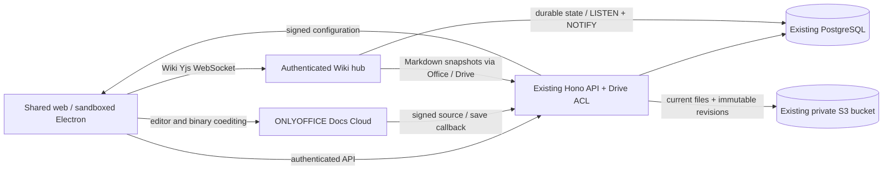

# Office, Wiki and Drive implementation results

> Follow-up: [file management and Markdown editor improvements](file-management-improvements.md) records the current module routes, merged inventory and CodeMirror 6 + Yjs Wiki editor. That work supersedes the Milkdown frontend and ProseMirror live-state format described in this original implementation report. ONLYOFFICE binary editing, Drive/S3 integration and the historical Cloud acceptance evidence below remain applicable.

## Status — October 20, 2026

Docs, Sheets and Slides use the actual ONLYOFFICE Docs Cloud tenant. Wiki uses the **user-approved Wiki-only Milkdown + Yjs fallback**. The implementation extends the existing Drive/S3 services and shared web/Electron app; Drive has not been rebuilt. Final regression and live acceptance checks are recorded below. The reproduced Drive CORS failure and a separate multipart signing defect are repaired and verified with actual S3 transfers on web and Electron.

The plan was already modified before work began; those user edits are preserved. The numbered architecture documents retain historical planning rationale with explicit updates for the implemented editor selection.

## Research and reference review

Read the complete Office plan, `AGENTS.md`, README, numbered docs 2–5, all three earlier implementation plans, Drive/storage/desktop notes, UI documentation, workspace manifests and environment/build configuration. Audited the actual Hono middleware, Better Auth/workspace locks, Drive routes/service/storage/cleanup, database schema/migrations, contracts, shared router/query/dialog components and Electron sandbox/transport/download/CSP boundaries before implementation.

Ran installed `pnpm exec intent list` and loaded the local Router core/auth guidance. Used pnpm, installed Turborepo 2.11.8 docs, React and AWS SDK guidance. The browser skill's CLI was unavailable; used the repository's installed Playwright rather than downloading a replacement. Oxfmt/Oxlint remain the only format/lint tooling. No future application or editor package was scaffolded.

### Reference image inventory

All ten images in `docs/ui_samples/documents_flow/` were opened with the image viewer. No accompanying text files were found in that directory.

| Reference | Observed UX direction |
| --- | --- |
| `1_Docs/1_docs_page.png` | Dark workspace shell, compact Docs heading/actions, filter tabs, search, bordered empty state and create action |
| `1_Docs/2_docs_page_with_items.png` | Dense document rows with type icons, title and last-editor metadata |
| `2_Sheets/1_sheets_page.png` | Spreadsheet empty state, import/create actions within the same shell |
| `2_Sheets/2_sheets_page_with_items.png` | Spreadsheet rows, green type icons, last-edited metadata |
| `2_Sheets/3_spreadsheet_editor.png` | Compact title/back bar, editor fills the remaining workspace area, bounded scrolling |
| `3_Slides/1_slides_page.png` | Presentation empty state and create action |
| `3_Slides/2_slides_page_with_items.png` | Presentation cards with thumbnails and title/slide-count metadata |
| `3_Slides/3_slides_editor.png` | Title/back bar, slide thumbnails, presentation canvas and tools |
| `4_Wiki/1_wiki_page.png` | Wiki landing with a knowledge-space card and page count; no detailed page-tree/editor sample supplied |
| `5_Drive/1_drive_page.png` | Drive create/upload, view pills, search, list/grid toggle, bordered empty state, usage footer |

These are visual references, not evidence of working functionality. Reuse the current semantic theme and Radix primitives. ONLYOFFICE owns its ribbon/grid/slide editor; do not recreate the sample editor controls. Do not copy the Docs sample's statement that everyone can edit: current Drive files are private until authorized. Wiki implements root pages and nested children; no unseen editor controls were inferred from the sample.

## Live provider proof and Wiki decision

The initial environment lacked tenant settings. The user configured the actual Cloud tenant secret in ignored `apps/api/.env`. Live signed `version` and `license` commands returned:

- Docs **10.0.0, build 169**; working signed configuration and protected HTTPS source download.
- Active trial (`resultType=3`), expiry **2026-11-20T07:19:26Z**, reported connection quota **20** and `users_count=1000`. These are observed tenant values, not product guarantees or permanent free capacity. Commercial distribution/production licensing still requires the owner's contract review.
- Real DOCX/XLSX/PPTX editors, real callback traffic, and synthetic edits saved in the configured private S3 bucket. The PPTX starter includes its required slide master/layout/theme relationships; no vendor sample or user content is embedded in production templates.
- Native `.md` coediting and callbacks worked, and the returned file really was Markdown. However, `#`/`##` headings became bold text and a fenced `ts` language identifier was removed. It failed the plan's fidelity gate. The user explicitly approved **Milkdown + Yjs for Wiki only**. Office binaries retain ONLYOFFICE synchronization exclusively.

The isolated provider spike used temporary synthetic S3 fixtures and distinct provider users. It was followed by the integrated LumoLynk proof with two actual LumoLynk accounts, shared canonical Drive files, real S3 revisions, and compiled Electron protocol/CSP/IPC. The spike alone is not counted as product acceptance.

Official references: [Cloud setup](https://api.onlyoffice.com/docs/docs-api/get-started/installation/cloud/), [React wrapper](https://api.onlyoffice.com/docs/docs-api/get-started/frontend-frameworks/react/), [callbacks](https://api.onlyoffice.com/docs/docs-api/usage-api/callback-handler/), [save lifecycle](https://api.onlyoffice.com/docs/docs-api/get-started/how-it-works/saving-file/), [coediting](https://api.onlyoffice.com/docs/docs-api/get-started/how-it-works/co-editing/), [JWT](https://api.onlyoffice.com/docs/docs-api/get-started/how-it-works/security/), [drop](https://api.onlyoffice.com/docs/docs-api/additional-api/command-service/drop/), and [license](https://api.onlyoffice.com/docs/docs-api/additional-api/command-service/license/). No DocSpace SDK or demo save handler is used.

## Integration contracts and implemented behavior

- **One canonical file:** an Office association uses the existing Drive item UUID and workspace. Opening an imported OOXML file attaches it in place after package validation. Creation uses Drive initialize/complete and the existing storage boundary. Name, parent, owner, grants, favorites, trash and download remain Drive operations. Documents inventory includes authorized files inside nested Drive folders; shared inventory includes inherited access.
- **No second file platform:** the existing AWS region/bucket/credential chain and `Storage` interface are reused. The only storage extension is an optional content type for server writes. Starter files are authored valid OOXML packages. Office snapshots use private `office/<workspace>/<item>/versions/<random-id>` keys in the same bucket.
- **Authorization:** metadata/config/source/history/restore/share-item/Wiki session and WebSocket updates recheck membership and the existing effective Drive ACL. Workspace locks serialize permissions, versions and destructive file operations. Source capabilities pin actor/workspace/document/version/generation and expire after five minutes. Browser and Electron iframe cookies are unnecessary.
- **Provider lifecycle:** complete configurations are signed on Hono using HS256. All users of a generation share a globally scoped hashed key. Force saves retain that key; final saves advance the generation. Signed callback claims are authoritative, including wrapped payloads; unsigned body changes cannot override them. Statuses 1/2/3/4/6/7 are handled explicitly. Duplicate save receipts are deduplicated, stale generations rejected, and failures retain the previous current revision. Receipts retain only fingerprints, not provider URLs. Save retrieval and promotion serialize so network completion cannot reorder overlapping accepted callbacks. Version restoration writes another immutable revision.
- **Download safety:** provider URLs require the exact configured HTTPS origin, no credentials/redirects, public DNS resolution pinned to the TLS connection, byte/ZIP expansion limits, and matching OOXML/UTF-8 structure. IPv4 and IPv6 deny lists are separate so mapped-IPv6 rules do not reject legitimate IPv4. Content is bounded at 64 MiB; Wiki Markdown at 2 MiB, CRDT state at 4 MiB.
- **Revocation:** grant/role/membership changes disconnect provider editors whose effective write access is lost. Rights preserved by another inherited grant are respected. New configuration/source/version requests immediately recheck access. The shared editor unmounts on metadata denial or permission/generation change. Previously downloaded/cloud-cached content cannot be recalled; the provider's documented `drop` operation prevents further editing and may leave cached viewing until the app removes the iframe.
- **Wiki:** a relational parent/position tree is distinct from Drive navigation. Each page has one `.md` file and a Drive folder container for inherited page/subtree access. Root/child creation, expandable navigation, authorized title search, rename, reparent/reorder with cycle/depth checks, single-page duplicate, subtree trash, container-based restoration and sharing are implemented. Direct Drive moves/trash of the page file are rejected so the tree is not silently broken. Use the containing folder for Drive subtree management.
- **Durable collaboration:** standard Yjs/y-websocket and y-protocols messages use short-lived authenticated tickets and exact Origin checks. PostgreSQL persists validated state and updates before broadcasting. Viewer mutations, stale generations and awareness impersonation are rejected. Debounced private Markdown snapshots supply Drive downloads/history; unsnapshotted durable state is recovered when reopening. Connection leases protect destructive operations; ping/pong, payload/queue/rate bounds and retained-update compaction bound abandoned sessions and resources. PostgreSQL LISTEN/NOTIFY forwards updates/awareness between API instances, reconnects and resubscribes after connection loss. A 15-second durable-state reconciliation recovers missed content notifications, retries pending snapshots after storage recovery, and expires abandoned leases. Reconnect and missed-notification recovery have regression coverage.
- **Shared UI:** Documents reuses Drive uploads, views, list/grid, search, filters, sharing, favorites, copy/move, trash/restore and native downloads. Docs/Sheets/Slides and Wiki have shared routes and enabled navigation. Editors load lazily into a bounded full-height shell. The title, persisted revision/time, access, share and history controls surround the genuine editor. History closes the editor before restore and exposes restoration only to file managers. Editor configuration is static for a generation/permission so ordinary rename/share/query invalidation cannot recreate an active iframe.
- **Electron:** the main process retrieves only the public configured provider origin for exact script/frame CSP allowances. The existing sandbox, context isolation, main-frame-only IPC and external-navigation policy remain. Revision downloads use the restricted native S3 download bridge. Copied document links use the configured web origin, not `lumolynk://app`.

## Runtime architecture

## API and schema

Authenticated paths under `/api/v1/workspaces/:workspaceId`:

| Path | Behavior |
| --- | --- |
| `/documents` | GET inventory; POST create any of the four types |
| `/documents/:id` | Authorized detail/Drive association |
| `/documents/:id/editor-config` | Signed binary Office configuration |
| `/documents/:id/save` | Authorized force-save command, outside the callback lock |
| `/documents/:id/versions` | Retained version metadata |
| `/documents/:id/versions/:versionId/download` | Authorized short-lived S3 download |
| `/documents/:id/versions/:versionId/restore` | New immutable restoration revision |
| `/documents/:id/share-item` | Canonical Drive item or Wiki container for sharing |
| `/wiki/pages` | Authorized tree and page creation |
| `/wiki/pages/:id` | Reparent/reorder or subtree trash |
| `/wiki/pages/:id/copy` | Duplicate one page |
| `/wiki/pages/:id/session` | Short-lived Yjs connection ticket |

Machine routes are limited to `/api/internal/onlyoffice/files/:id/:versionId`, `/api/internal/onlyoffice/callback/:id/:generation`, and authenticated WebSocket upgrades at `/api/internal/wiki/:id`. Only the signed Office machine routes bypass browser Origin/session checks; normal API/auth protections remain. `/api/config/office` exposes the public document-server origin only.

Migrations `0005` and `0006` add Office associations, immutable versions, callback receipts, Wiki tree/state/update log and expiring Wiki connection leases. Compound workspace FKs prevent cross-workspace associations. Unique indexes needed by compound FKs are created before the FK statements. These migrations were applied to the development database and are exercised from scratch in isolated test schemas. Cleanup protects retained versions and deletes them on an authorized purge before removing metadata; nested Wiki page references are removed in leaf order.

## Drive issue and integration repair register

| ID | Reproduction / affected flow | Root cause / result | Repair and regression evidence |
| --- | --- | --- | --- |
| D-001 | Original report says Drive has issues, without steps/platform/error | No separate symptom can be inferred | Kept unverified; no invented repairs |
| D-002 | High: 150-byte and 9-MiB single-PUT uploads fail on web/Electron; initialization succeeds, expected durable upload absent | S3 OPTIONS returns 403 `AccessForbidden`, no ACAO; identical PUT succeeds outside browser. After the user granted CORS administration, `GetBucketCORS` confirmed no bucket configuration existed | **Fixed.** Backed up the empty configuration in ignored local storage; applied the exact-origin development rule from `docs/drive-cors.example.json`. All six configured preflights pass. Real web/Electron uploads, range previews and downloads pass. Diagnostic success/failure regressions added; no alternate upload server or wildcard-origin workaround |
| D-003 | High: actual 17-MiB uploads initialize as multipart, then all part PUTs fail on web/Electron; expected completion never occurs | Actual Node and browser part PUTs return HTTP 403 `SignatureDoesNotMatch`. Shared presigner options signed an SDK-generated Content-Type that the part client does not send; independent of CORS | **Fixed.** UploadPart excludes incidental Content-Type from signing while retaining signed Content-Length and SHA-256 checksum. Single PUTs still bind their declared MIME type. Actual-presigner regression asserts the exact multipart signed-header set; real 17-MiB web/Electron uploads complete and full downloaded hashes match original bytes |
| O-001 | Native Cloud Markdown save changes headings and fenced-code language | Provider fidelity limitation on tested build | Approved Wiki-only Milkdown/Yjs; real round-trip, convergence and deletion tests |
| O-002 | Naive blank PPTX does not open | Missing master/layout/theme parts | Authored complete minimal starter; real Cloud editor/save proof and package tests |
| O-003 | Wiki connects without completing initial synchronization | Client's first sync packet arrived before async state/ACL loading attached handlers | Pause/resume socket during setup; real HTTP-upgrade regression |
| O-004 | Presence changes reset Wiki typing | Unstable React editor getter caused repeated collab disconnect/reconnect | Bind once on actual editor creation; real Milkdown lifecycle/presence tests and two-account live proof |
| O-005 | Normal y-websocket awareness relay rejected second user | Server treated relayed remote states as an identity takeover | Accept protocol relay while only applying the socket's owned identity; spoofing regression |
| O-006 | Live Cloud save refused although origin matched | IPv4-mapped IPv6 `BlockList` subnet also matched public IPv4 | Split family deny lists; public/private/mixed DNS, redirect, TLS and byte-cap regressions; real S3 save proof |
| O-007 | Rename/share invalidation can recreate a provider iframe | Active config query was invalidated with file metadata | Static config per generation/permission; regression asserts one config issuance across rename/share/save |
| O-008 | Nested Office files disappear from Documents inventory | Drive's root-folder listing semantics were reused without an inventory mode | Reuse Drive authorization/query with explicit internal inventory scope; nested inherited-share tests |
| O-009 | Version-aware cleanup can inspect an obsolete status while waiting for workspace lock | File lookup happened before the serialization lock | Re-read file under lock; retained/purge/cleanup integration tests |
| O-010 | Standalone/copied Markdown can be routed into Wiki without a Wiki association; Wiki file menus offer operations rejected by tree guards | Extension/MIME classification alone does not establish Wiki membership | Check the authorized Office association before Wiki navigation; otherwise preview standalone Markdown as text. Wiki move/copy/trash use page management. Shared-route regressions cover registered pages, plain Markdown and denied access |

The 9-MiB file is below the existing 16-MiB multipart threshold; it is single PUT evidence. The separate 17-MiB verification exercises three actual parts (8 + 8 + 1 MiB), finalization and complete downloaded-byte comparison. The original unspecified Drive report remains unverified beyond the concrete failures reproduced above.

The Office-phase changes to Drive were integration prerequisites: MIME-aware writes, canonical inventory, version-retention cleanup, active-editor/tree guards and shared ACL hooks. General Drive diagnostics started after live Office/Wiki editing and S3 persistence were demonstrated. The two reproduced transfer failures were repaired in configuration and the existing S3 adapter.

## Deployment, diagnosis and recovery

1. Install pinned dependencies with `pnpm install`; back up PostgreSQL and preserve S3 data before migrations. Run `pnpm db:migrate` once through the existing migration workflow. No Drive backfill/reupload is required; OOXML imports attach on first open.
2. Configure all three server-only settings in `apps/api/.env.example`. Use exact public HTTPS origins without trailing slash. Keep `API_ORIGIN` canonical and identical across replicas because it scopes provider keys. `ONLYOFFICE_MODE` records Cloud vs self-hosted; both use the same supported Docs API contract.
3. Reuse the private S3 bucket/role. Add `office/*` alongside the existing Drive object-action prefixes. Do not expire `drive/` or `office/` indiscriminately: they contain current files, Trash and retained versions. Cleanup intents/maintenance remove failed snapshots and authorized purges. Existing archive/staging lifecycle backstops remain.
4. Configure bucket CORS for the actual web and Electron origins, PUT/GET/HEAD and checksum/range headers. Merge the prepared example with existing rules rather than replacing unknown configuration. See [AWS CORS elements](https://docs.aws.amazon.com/AmazonS3/latest/userguide/ManageCorsUsing.html). CORS permissions are bucket administration and can be removed from the backend identity after repair.
5. Run `pnpm --filter @lumolynk/api onlyoffice:check` for `api.js`/public API reachability and `pnpm --filter @lumolynk/api drive:check` for storage browser preflights. Neither prints credentials, bucket URLs or signed capabilities. Reachability/preflight success alone does not prove editing or saving.
6. Start the API with WebSocket upgrade support. HTTPS ingress must forward the signed source/callback paths and Wiki WebSockets; keep the configured web Origin and `lumolynk://app` behavior. Reserve one PostgreSQL connection per API for LISTEN/NOTIFY. No sticky session is required for stored Wiki content; database/egress capacity still needs deployment load testing. LISTEN reconnects automatically; periodic state reconciliation recovers content changes missed during an interruption.
7. Observe sanitized request IDs, route/status/timing, machine failure codes and `office.*` audit events. Do not log request bodies, provider URL paths, tokens, raw environment or private object keys. On callback/S3 failure, retain provider caches and the last saved revision, restore connectivity and retry saving. Do not delete or manually rotate an active generation. Force-save commands run outside the workspace lock so callbacks can ACK.
8. For Wiki snapshot failure, state/update commits remain in PostgreSQL. Keep the page open after storage recovery: the heartbeat retries dirty snapshots. A new connection also recovers unsnapshotted state into Markdown. Restore old versions only after all editors close. Successful restore creates a new revision; it never erases history.
9. If an Office opening failed before callbacks established/closed the session, retry opening the same generation and close it cleanly to obtain status 4/2. Do not clear editing state or purge content merely because a browser disappeared. A provider outage may require operator recovery; no unsafe timed deletion of active Office state is implemented.

### Cloud-to-self-hosted cutover

Stop issuing new Office sessions, wait for final saves/idle state, verify current/retained S3 checksums and back up metadata. Provision a licensed supported Docs server with public HTTPS reachability and matching JWT configuration. Private/loopback-only download endpoints are intentionally rejected. Change server origin/secret/public callback ingress and `ONLYOFFICE_MODE=self-hosted`; keep the canonical API origin, Drive IDs, folders, ACLs and revision objects. Restart API and Electron so their exact provider CSP origin is refreshed. Run signed source/config/callback, two-user binary editing, final/force saving, history/reopen, web/Electron and recovery checks before admitting users. Retain previous revisions for rollback. A trial expiry does not delete LumoLynk's saved S3 files or Wiki state.

## Verification evidence and limits

- Baseline: 219 API/web/desktop/env tests passed before implementation. A later foundation gate passed 279 tests before the main Office changes.
- `pnpm check:all:build` passes: formatting, type-aware lint, workspace boundaries, dependency checks, generated routes, all type checks, **333 tests in 38 files**, and **all four build tasks**. Coverage: **95.65% statements, 90.21% branches, 95.55% functions, 97.29% lines**, with the existing 90% thresholds unchanged. Compiled API startup/readiness also passes. Existing Agora SDK build warnings are unchanged.
- Automated scope: API tests use real isolated PostgreSQL schemas/migrations, actual authentication and ACL routes, deterministic provider/storage boundaries for fault injection, and real HTTP/WebSocket upgrades. UI tests exercise real shared routes/dialogs and real Milkdown/Yjs lifecycle with controlled network boundaries.
- Real Cloud/S3: signed tenant version/license and native Markdown spike; two actual LumoLynk accounts opened the same DOCX/XLSX/PPTX and Wiki files; immutable S3 bytes were inspected for valid OOXML/UTF-8 and synthetic edits. Wiki converged both ways and an Electron edit appeared in web. Compiled Electron used real provider frames and native application transport; Docs/Sheets/Slides edits produced saved revisions. Synthetic screenshots/debug state stay in ignored `.local`, never in the repository.
- Browser baseline regression: `pnpm test:e2e` — **13 passed, 1 skipped** (mobile classic-scrollbar-thumb case).
- Browser rerun note: one mobile Rename-menu timing timeout occurred during concurrent development/check activity; its isolated rerun and the final uninterrupted full suite passed. No forced clicks, increased timeouts or product repair are claimed for that intermittent observation. Browser and Electron suites must run sequentially because their existing configurations share ports/artifacts.
- Electron baseline regression: `xvfb-run -a pnpm test:desktop` — **3 passed, 5 skipped** (window-manager-dependent native controls and opt-in live Agora/capture). This is Linux/Xvfb evidence, not an unperformed Windows/macOS or signed-installer acceptance claim.
- Live Wiki tree: browser child creation and inherited access, durable rich editing, single-page duplication, reparent/reorder with access recalculation, subtree Trash and Drive restoration/reopening all pass.
- Live history/access: web and Electron restored a retained spreadsheet version into a new generation and reopened the genuine editor. Electron downloaded the retained revision through its native bridge. Shared viewer mode opened read-only; live revocation removed the provider frame and denied an already-issued source capability and history.
- Live Drive: real 150-byte / 9-MiB single PUTs and 17-MiB multipart transfers; full downloaded-byte/hash verification on both platforms; range text preview; native and browser downloads; S3 copy, ZIP archive, rename/move/star, inherited folder sharing, subtree Trash/restore/reload and revoked access. D-002 and D-003 have concrete before/after evidence. Standard backend/UI suites also cover cancellation/retry/finalization, cleanup/backoff, filters, ACL inheritance and version-retention conflicts.
- Temporary provider spike objects are removed by the preflight server shutdown; its four initial objects were confirmed absent with S3 HEAD. Integrated proof cleanup removed **4 synthetic users, 6 isolated workspaces, 31 files and 88 exact object keys** after validating identities, ownership, membership and closed sessions; private screenshots/session artifacts remain ignored locally. A prior interrupted test opening was recovered on the primary development API by reopening and closing cleanly. The main development callback tunnel remains available for the configured API.

Known limits: CommonMark Wiki (no custom GFM table extension), bounded page/file/message sizes, snapshot history rather than provider visual diffs, single-page Wiki duplication, polling for Office metadata, unavoidable previously cached content after revocation, temporary development ingress, no native mobile implementation, no production-scale/load or Windows/macOS acceptance claim, no permanent Cloud licensing guarantee. A failed provider opening can need operator recovery rather than expiring an editing state unsafely. Provider callbacks have no trustworthy global edit sequence: generation boundaries prevent stale-final writes; immutable same-generation snapshots preserve accepted arrivals for recovery. These limits are explicit rather than mock implementations or silent data conversion.
